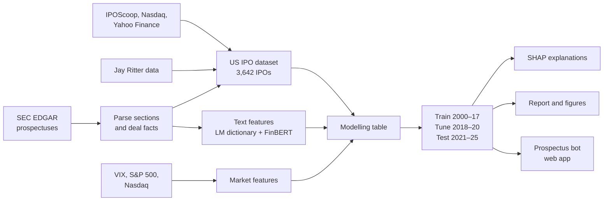
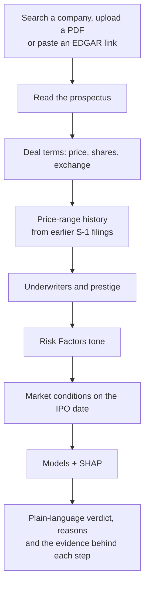

# Reading the Prospectus

**An NLP-Driven Machine Learning System for Predicting First-Day IPO Returns in the US and Nigeria**

## Project overview

Companies going public often price their shares below what the market will pay: US IPOs in this project's sample
closed their first trading day 16.8% above the offer price on average, and 69% of them "popped" (closed above it).
This project asks whether that first-day return can be predicted from information that is public **before trading
starts**, and in particular whether **reading the prospectus** with natural language processing adds anything to the
classic deal-level predictors.

It builds a dataset of 3,642 US operating-company IPOs (2000–2025) with their final prospectuses from SEC EDGAR,
scores the prospectus text with the Loughran-McDonald financial dictionary and FinBERT, and trains machine learning
models with a strict time split. Nigerian (NGX) listings are studied as a separate case, because the exchange's 10%
daily price limit changes how a first-day return should be measured. The models are served by a web app, the
"prospectus bot", that reads any prospectus and explains its prediction step by step.

## Project objectives

1. Build a clean, reproducible dataset of US IPOs with deal, firm, underwriter, market and prospectus-text features.
2. Extract tone features from prospectuses with a financial dictionary (Loughran-McDonald) and a financial language
   model (FinBERT).
3. Predict whether an IPO pops on day one, and which return bucket it falls into.
4. Test, with an honest out-of-sample design, whether prospectus text improves on deal and market variables.
5. Explain the predictions (SHAP) and compare the US results with Nigerian listings.
6. Deliver the models as a web application that analyses a prospectus on demand.

## Research questions

1. Can deal, firm, market and prospectus-text features predict first-day IPO pops and return buckets better than a
   price-revision-only baseline?
2. Does prospectus language (tone, uncertainty, FinBERT sentiment) add predictive power beyond the numbers?
3. How do Nigerian IPOs compare, given NGX's daily price limit and its different market structure?

### Prediction targets

| Target | Definition |
|---|---|
| `pop` | First-day return > 0% (69% of the US sample) |
| `pop10` | First-day return > 10% (45%) |
| `bucket` | Overpriced (< 0%) · Fair (0–10%) · Underpriced (10–30%) · Heavily underpriced (> 30%) |

First-day return = (first close − offer price) / offer price. For Nigeria it is measured up to the first session
that closes inside the daily limit (at most 10 sessions), with the raw day-one return kept alongside.

## Dataset description and sources

| Source | What it provides |
|---|---|
| [IPOScoop](https://www.iposcoop.com) track record (2000 – Sep 2020) | Offer price, first-day close, lead managers, including later-delisted firms |
| Nasdaq IPO calendar API + Yahoo Finance (`yfinance`) | Deals and first-day prices after September 2020 |
| [Jay Ritter's IPO data](https://site.warrington.ufl.edu/ritter/ipo-data/) | Founding year, VC backing, dual-class shares; Carter-Manaster underwriter ranks |
| [SEC EDGAR](https://www.sec.gov/edgar) | Final prospectuses (424B4/424B1) and earlier S-1/F-1 filings with the initial price range |
| [Loughran-McDonald Master Dictionary](https://sraf.nd.edu/loughranmcdonald-master-dictionary/) (1993–2025) | Financial word lists: negative, positive, uncertainty, litigious, modal, constraining |
| Yahoo Finance | VIX, S&P 500 and Nasdaq Composite daily closes |
| NGX Daily Official Lists, news reports | Nigerian listings: offer or reference price and early trading prices |
| Kaggle *Stocks IPO information & results* | Cross-check only; not used as features (it covers only firms still listed in 2018) |

**Size after cleaning**

| | Count |
|---|---|
| US IPOs collected | 4,445 |
| US operating-company IPOs used (SPACs, units, funds, ADRs and offers under $5 removed) | 3,642 |
| Final prospectuses downloaded and parsed | 3,437 |
| Nigerian listings / with usable returns | 29 / 13 |

Coverage in the clean US sample: price range (for price revision) 81%, underwriter rank 93%, Risk Factors text 93%.
Details of every file are in [`data/README.md`](data/README.md).

## Tools and technologies

| Area | Tools |
|---|---|
| Language | Python 3.11 |
| Data collection | `requests`, `beautifulsoup4`, `lxml` (EDGAR and web pages), `yfinance`, `xlrd` / `openpyxl` (Ritter files), `pdfplumber` / `pypdf` / `pypdfium2` (PDFs) |
| Data processing | `pandas`, `numpy` |
| NLP | Loughran-McDonald dictionary (word counts, Fog readability), `transformers` + `torch` with [FinBERT](https://huggingface.co/ProsusAI/finbert) (`ProsusAI/finbert`) |
| Machine learning | `scikit-learn` (L1 logistic regression, random forest, pipelines), `lightgbm` |
| Explainability | `shap` |
| Visualisation | `matplotlib` |
| Web app: backend | `fastapi`, `uvicorn`, Docker, deployed on Railway |
| Web app: frontend | Next.js, React, TypeScript, Tailwind CSS, deployed on Vercel |
| Testing and version control | `pytest`, Git, GitHub |

## Methodology



1. **Data collection.** Deals from IPOScoop (to 2020) and the Nasdaq calendar with Yahoo Finance prices (2020–2025),
   matched to Ritter's firm data and to each company's EDGAR filings. All downloads are scripted and resumable
   (`src/pipeline.py`).
2. **Cleaning.** SPACs, units, closed-end funds, ADRs and offers under $5 are removed. Yearly mean and median
   first-day returns are checked against Ritter's published statistics (correlation 0.85 and 0.88).
3. **Prospectus parsing.** Each final prospectus is split into Summary, Risk Factors and Use of Proceeds, and the
   offer price, share count, underwriters and syndicate size are extracted. The initial price range comes from the
   company's earlier S-1/F-1 filings, giving the **price revision** (offer price vs. the range midpoint).
4. **Feature engineering.**
   - *Deal:* deal size, offer price, price revision, priced above / below the range, range width, Nasdaq listing.
   - *Firm:* age, VC backing, dual-class shares, internet firm, roll-up.
   - *Underwriter:* lead-bank prestige (Carter-Manaster rank), syndicate size.
   - *Market:* VIX, S&P 500 and Nasdaq returns over the prior 21 sessions, number and mean first-day return of IPOs
     in the prior 30 days.
   - *Text:* Loughran-McDonald word shares and Fog index for the whole document and each section; FinBERT positive,
     negative and net sentiment of 16 sentences sampled from each section; tone relative to IPOs of the prior 365
     days (corrects for language drifting over the years).
   - **Leakage rule:** only information public before the first trade is used. Prices after the offer, analyst
     ratings and the IPO year are excluded.
5. **Modelling.** A strict time split: train on 2000–2017 (2,707 IPOs), tune on 2018–2020 (497), test once on
   2021–2025 (438). Baselines (majority class, price revision only) against L1 logistic regression, random forest and
   LightGBM, each fitted **with and without** the text features. The setting chosen on the validation years is refit
   on train + validation and scored on the test years.
6. **Evaluation.** ROC-AUC and accuracy for `pop` and `pop10`, macro-F1 for `bucket`. The effect of the text
   features is tested with a paired bootstrap (1,000 resamples) of the test-set score difference.
7. **Explanation.** SHAP values for the chosen models, overall and for each prediction.
8. **Nigeria.** Listings assembled from the NGX Daily Official Lists and news reports; returns measured to the first
   session that closes inside the 10% limit, and compared descriptively with the US results.
9. **Deployment.** The chosen models are refit on all years and served by the web app.

### The prospectus bot



The search covers any company on SEC EDGAR and shows its IPO status (priced, upcoming, withdrawn, already public).
For an upcoming IPO the bot predicts at the middle of the current price range.

## Key results (test years 2021–2025)

| Target | Best model | Score | Price revision alone |
|---|---|---|---|
| Pop (> 0%) | LightGBM, without text | ROC-AUC 0.777 | 0.703 |
| Pop > 10% | LightGBM, with text | ROC-AUC 0.784 | 0.727 |
| Bucket | Random forest, with text | macro-F1 0.428 | 0.198 |

- **Deal terms carry most of the signal** (65% of the SHAP explanation for `pop`), led by price revision: IPOs
  priced above their range rose 44.8% on day one on average, those below it 3.6%.
- **Prospectus tone adds little out of sample.** In 1 of 9 model-target comparisons the text features improve the
  test score beyond chance (Pop > 10% with L1 logistic regression, +0.031 AUC). The models chosen on the validation
  years use no text features.
- **Nigeria:** large listings closed exactly at the +10% limit on day one; measured to the first unconstrained
  session, returns reached +65.6%. With 13 usable listings, Nigeria is treated as a case study, not a modelling
  sample.

The full write-up is in [`reports/report.md`](reports/report.md).

## Repository layout

| Path | What |
|---|---|
| `src/pipeline.py` | Runs every step in order; safe to rerun |
| `src/data/` | Data collection and cleaning (IPOScoop, Nasdaq, Yahoo, Ritter, EDGAR, NGX) |
| `src/features/` | Text features (LM, FinBERT), market features, the modelling table |
| `src/models/` | Training and evaluation (`train.py`), SHAP explanations (`explain.py`) |
| `src/reports/` | Figures and the report builder |
| `data/` | Raw, interim and processed data |
| `results/`, `reports/` | Metrics, figures and the report |
| `models/` | The chosen models, used by the API |
| `api/`, `web/` | The prospectus bot: FastAPI backend and Next.js frontend |
| `deploy/` | Deployment guide (Railway and Vercel) |
| `tests/` | API tests |

## How to run

```bash
python -m venv .venv
.venv/Scripts/python -m pip install torch --index-url https://download.pytorch.org/whl/cpu
.venv/Scripts/python -m pip install -r requirements.txt
.venv/Scripts/python src/pipeline.py              # all steps; --list shows them
.venv/Scripts/python -m pytest tests -q
```

A first run takes several hours (SEC downloads are rate-limited, and FinBERT on a CPU takes about 4 hours); later
runs only do new work. The Kaggle CSV must be downloaded by hand into `data/raw/kaggle/IPODataFull.csv`.

Run the app locally:

```bash
.venv/Scripts/python -m uvicorn api.app.main:app --port 8000   # API, docs at /docs
cd web && npm install && npm run dev                             # site at http://localhost:3000
```

*A research project for a short course in data science. Not investment advice.*
