# Reading the Prospectus: An NLP-Driven Machine Learning System for Predicting First-Day IPO Returns in the US and Nigeria

*Short-course data science project. Generated from the pipeline outputs on {{generated}}; numbers update when
`src/pipeline.py` is rerun.*

## Summary

Firms going public tend to leave money on the table: US IPOs in our sample closed their first day
{{mean_return}} above the offer price on average (median {{median_return}}), and {{pop_rate}} of them "popped".
This project asks whether that first-day return can be predicted from information public before trading
starts, and in particular whether **reading the prospectus** with natural language processing adds to the
classic deal-level predictors.

We built a dataset of {{n_clean}} US operating-company IPOs from 2000 to 2025, read {{n_prospectus}} final
prospectuses from SEC EDGAR, scored their tone with the Loughran-McDonald financial dictionary and FinBERT, and
trained models with a strict time split (train 2000–2017, tune 2018–2020, test 2021–2025).

Key findings:

1. **First-day pops are predictable to a useful degree.** The best model reaches a test ROC-AUC of
   {{best_pop_auc}} for pop vs. no pop ({{best_pop_model}}), against {{pr_only_auc}} for price revision alone and
   0.5 for guessing.
2. **The deal terms carry most of the signal.** By SHAP, deal terms explain {{shap_deal_pop}} of the chosen pop
   model's predictions, led by the price revision: IPOs priced above their initial filing range rose
   {{above_mean}} on average on day one, those priced below it {{below_mean}}.
3. **{{text_headline}}** {{text_verdict}}
4. **Nigeria is different.** NGX's 10% daily price limit hides most of the first-day move: large listings
   closed exactly +10% on day one, but their return to the first unconstrained session reached {{ng_max}}.

## 1. Research questions

1. Does information extracted from the prospectus (tone, length, syndicate) improve first-day return
   predictions beyond deal and market variables?
2. Which factors drive the predictions?
3. How do Nigerian listings compare, given the NGX daily price limit?

## 2. Data

| Source | Use |
|---|---|
| IPOScoop track record (2000–Sep 2020) | Offer price, first-day close, lead managers, including later-delisted firms |
| Nasdaq IPO calendar API (2000–2025) + Yahoo Finance | Deals and first-day prices after Sep 2020 |
| Jay Ritter's IPO data | Founding year, VC backing, dual class; Carter-Manaster underwriter ranks |
| SEC EDGAR | {{n_prospectus}} final prospectuses (424B4/424B1) and earlier S-1/F-1 filings |
| Loughran-McDonald master dictionary (1993–2025) | Financial tone word lists |
| VIX, S&P 500, Nasdaq (Yahoo Finance) | Market conditions before each IPO |
| NGX Daily Official Lists, news reports | {{ng_n}} Nigerian listings, {{ng_with_returns}} with returns |

SPACs, units, closed-end funds, ADRs and penny stocks (offer below $5) are excluded, as are {{n_px_unreliable}}
deals whose post-2020 Yahoo prices needed more than a 10× reverse-split adjustment. The yearly mean and median
first-day returns track Ritter's published statistics closely (correlation 0.85 for means, 0.88 for medians).

**Prospectus coverage** in the clean sample: price revision {{cov_price_revision}}, underwriter rank
{{cov_uw}}, syndicate size {{cov_syndicate}}, Risk Factors text {{cov_risk}}. The offer price read from the
prospectus matches the dataset within 1% for {{cov_price_agree}} of documents.

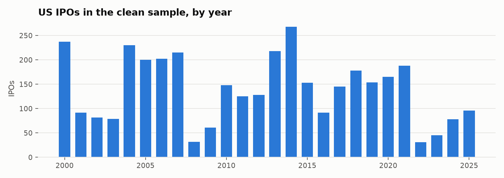
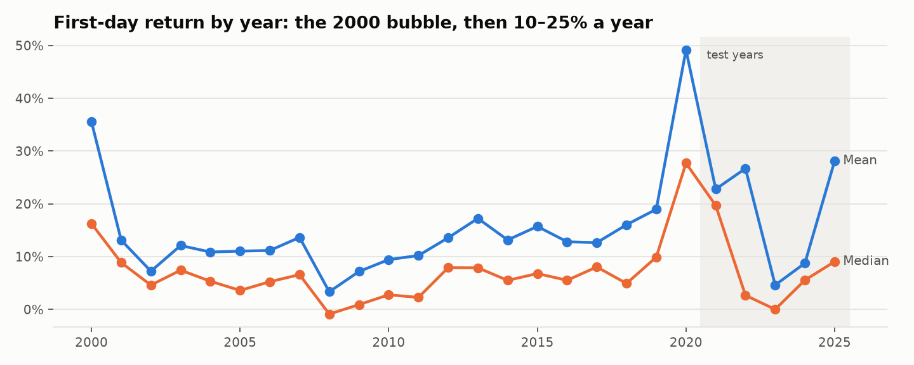

### Targets

- `pop`: first-day return > 0 ({{pop_rate}} of the sample)
- `pop10`: first-day return > 10% ({{pop10_rate}})
- `bucket`: overpriced (< 0) · fair (0–10%) · underpriced (10–30%) · heavily underpriced (> 30%)

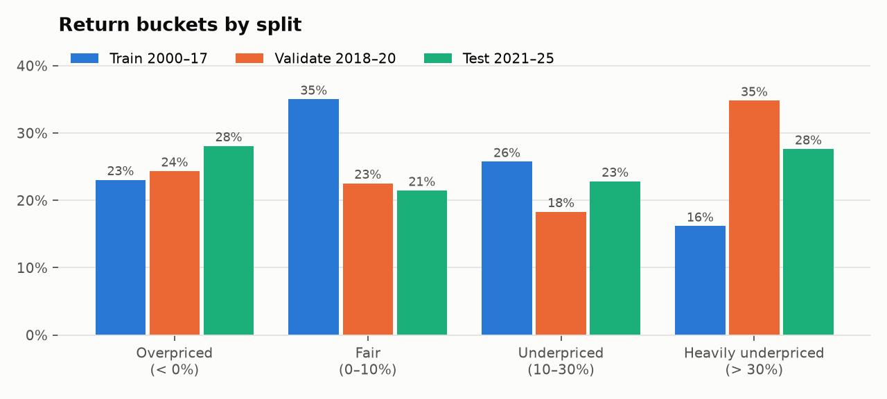

The test years differ from the training years: heavily underpriced IPOs make up {{bucket_heavy_train}} of
2000–2017 but {{bucket_heavy_test}} of 2021–2025, a shift any model has to cope with.

## 3. Features

| Group | Features |
|---|---|
| Deal | Deal size, offer price, price revision vs. the initial filing range (above / below range, range width), Nasdaq listing |
| Firm | Age, VC backing, dual-class shares, internet firm, roll-up |
| Underwriter | Lead underwriter prestige (Carter-Manaster rank), syndicate size |
| Market | VIX, S&P 500 and Nasdaq returns over the prior month, number and mean first-day return of IPOs in the prior 30 days |
| Prospectus length | Whole document, Risk Factors section |
| LM tone | Share of negative, positive, uncertain, litigious, strong/weak modal and constraining words, and Fog readability, for the whole document, Summary, Risk Factors and Use of Proceeds |
| FinBERT tone | Mean positive, negative and net sentiment of 16 sentences sampled evenly through each of Summary, Risk Factors and Use of Proceeds |

Only information public before the first trade is used. The IPO year is not a feature (test years lie outside the
training range); Kaggle financials are not used because they exist only for firms that survived to 2018.

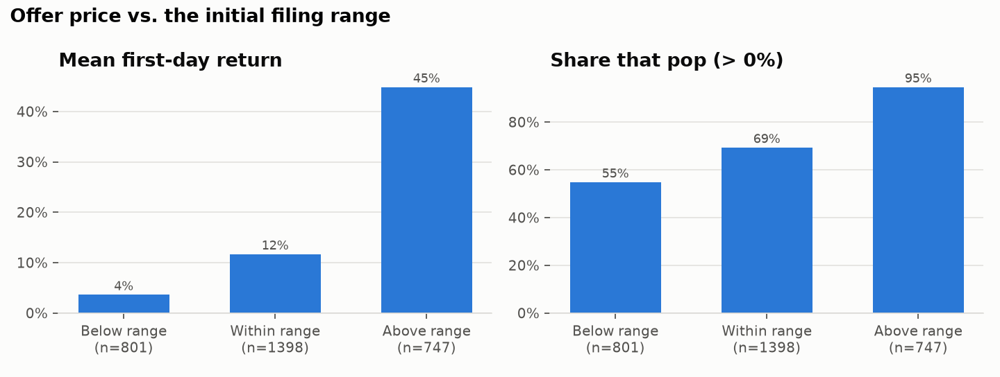
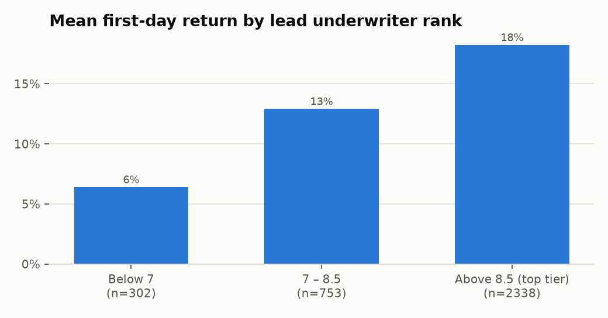
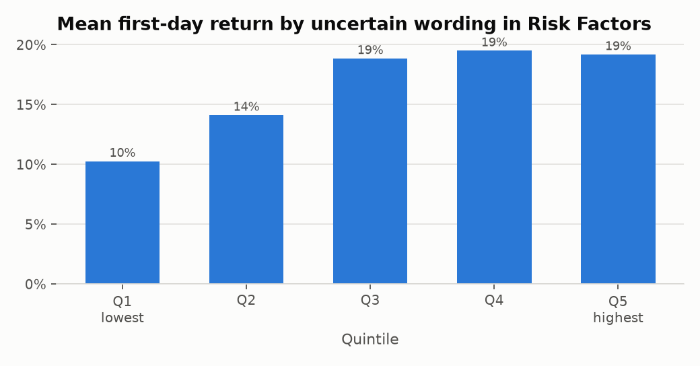
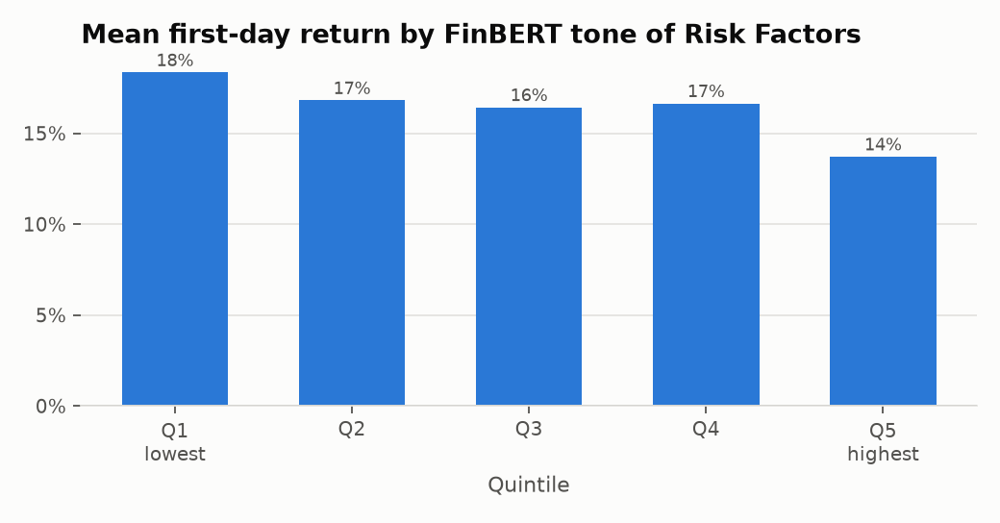

{{eda_revision_table}}

## 4. Method

- **Split:** train 2000–2017 ({{n_train}} IPOs), validation 2018–2020 ({{n_val}}), test 2021–2025 ({{n_test}}).
- **Models:** majority class and price-revision-only logistic regression as baselines; L1 logistic regression,
  random forest and LightGBM, each fit **with** and **without** the prospectus text features.
- **Tuning:** a small grid per model, chosen on validation ROC-AUC (macro-F1 for buckets); the chosen setting is
  refit on train + validation and scored once on the test years.
- **Does text help?** Paired bootstrap ({{n_boot}} resamples of the test set) of the score difference between
  the text and no-text version of each model.
- **Explanations:** SHAP values for the chosen models.

## 5. Results

### 5.1 Model performance (test years 2021–2025)

{{metrics_table}}

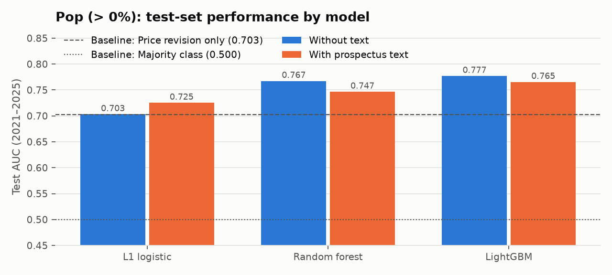
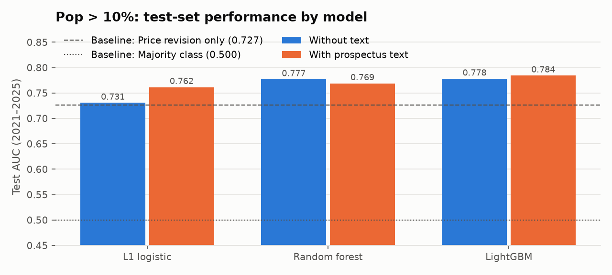
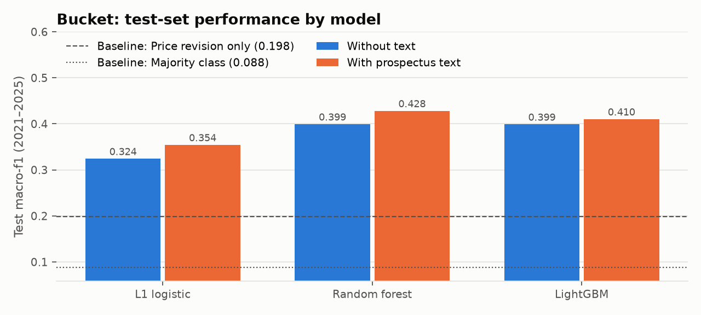

The bucket model separates the extremes better than the middle:

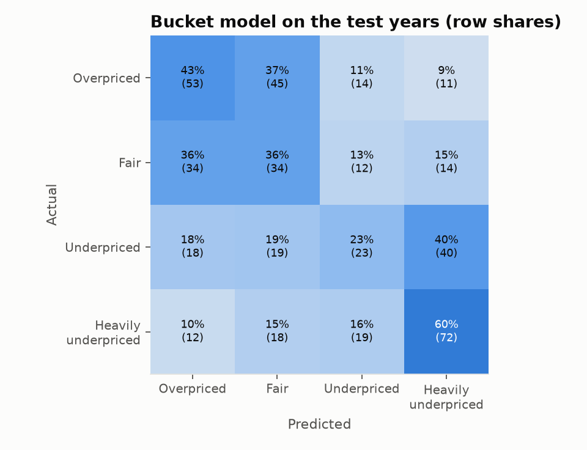

**A simple economic check:** buying only the IPOs the chosen pop model favours (probability ≥ 0.5) would have
earned a mean first-day return of {{strategy_return}} on the test years, against {{all_return}} from buying every
IPO, while still buying {{strategy_share}} of deals. (First-day allocations are rationed in practice, so this
measures signal, not a tradable strategy.)

### 5.2 Does reading the prospectus help?

{{text_effect_table}}

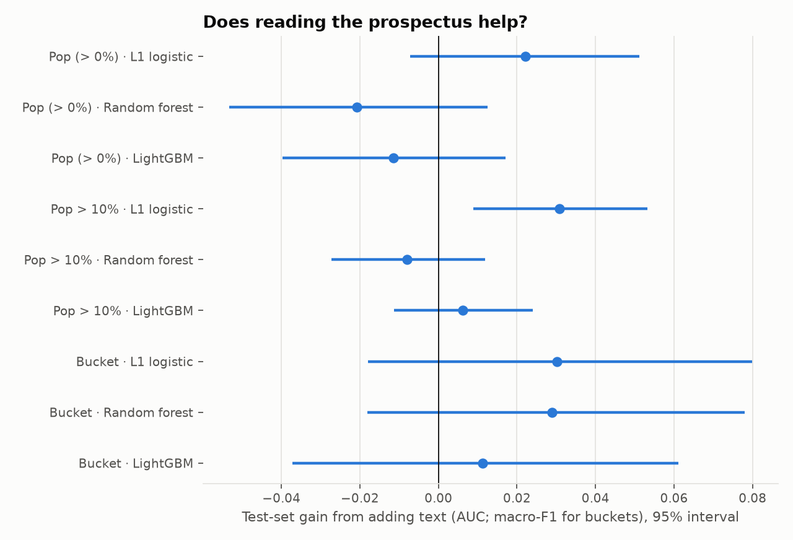

{{text_verdict}}

### 5.3 What drives the predictions

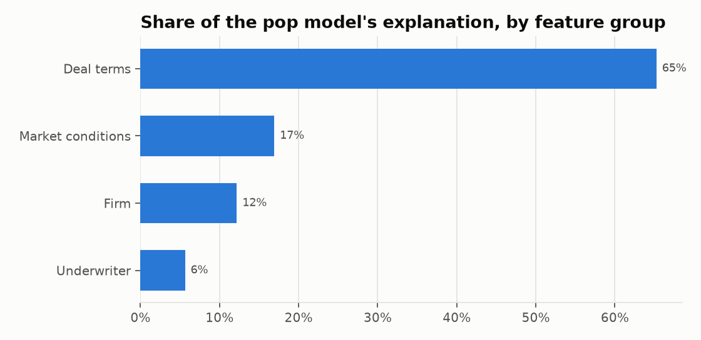
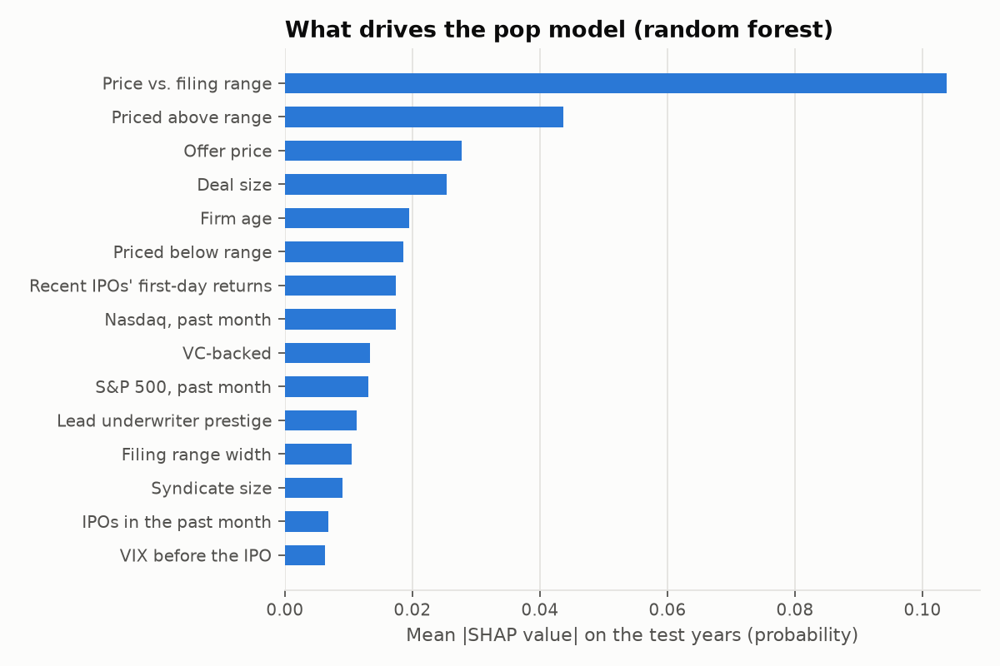

{{shap_text}}

## 6. Nigeria

{{nigeria_table}}

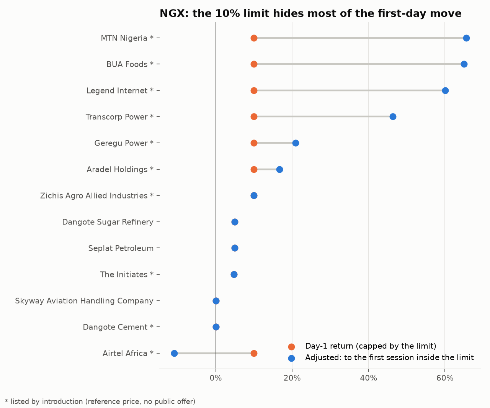

There is no bulk source of Nigerian IPO data, so the sample was assembled listing by listing from the NGX Daily
Official Lists (from late 2014) and news reports. Most large recent listings were **introductions** (existing
shares admitted at a reference price, with no public offer), so they measure price discovery rather than
underpricing.

The NGX daily limit (5% before 2012, 10% since) censors the first-day return. Every large introduction from 2019
to 2025 closed exactly at the limit on day one, and most again on day two. Measured to the first session that
closed inside the limit, MTN Nigeria rose {{ng_mtn}}, BUA Foods {{ng_bua}} and Legend Internet {{ng_legend}}. With
{{ng_with_returns}} listings and different mechanics, the US models are not applied to Nigeria as a statistical
test; the web app flags Nigerian prospectuses and explains the limit instead.

## 7. The prospectus bot

The models are served by a web application: a FastAPI backend (`api/`) and a Next.js frontend (`web/`). Given an
EDGAR link or an uploaded PDF/HTML prospectus, it extracts the deal facts, finds the initial price range in the
company's earlier S-1 filings, scores the text, fetches market conditions for the IPO date, and returns the pop
probability, the bucket probabilities and the SHAP reasons. Deployment instructions are in `deploy/README.md`.

## 8. Limitations

- **Survivorship after September 2020:** Yahoo Finance has no history for delisted tickers, so the 2021–2025 test
  set holds only firms still trading; test returns are biased upward and the test set is smaller than the market.
- **Missing range data:** {{cov_price_revision_missing}} of IPOs have no initial filing range, so the strongest
  predictor is missing for them.
- **FinBERT on a sample:** FinBERT scores 16 sentences per section on a CPU, not whole sections.
- **Nigeria:** too few listings for modelling; pre-2014 prices come from news reports only.
- **Not investment advice:** first-day allocations go mostly to institutions, and the models' accuracy is modest.

## 9. Reproducing

```bash
.venv/Scripts/python src/pipeline.py       # data → features → models → figures → this report
```
